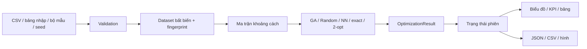

# Kiến trúc hệ thống

## Mục tiêu thiết kế

Tách biệt thuật toán với giao diện để có thể kiểm thử TSP mà không khởi chạy Streamlit. Một dataset bất biến là đầu vào chung của mọi thuật toán. Các bộ giải trả về cùng một kiểu kết quả, cho phép trực quan hóa, so sánh và xuất dữ liệu mà không cần tính lại lời giải.

## Các lớp chức năng

| Lớp | Module | Trách nhiệm |
|---|---|---|
| Giao diện | `app.py` và các module UI | Điều hướng, widget, trạng thái phiên, thông báo lỗi |
| Dữ liệu | `models.py`, `data_loader.py`, `validation.py` | Kiểu dữ liệu, CSV, kiểm tra tính hợp lệ |
| Hàm mục tiêu | `distance.py` | Ma trận Euclid và chiều dài tuyến khép kín |
| Bộ giải | `algorithms/` | Tìm tuyến; không phụ thuộc Streamlit |
| Phân tích | `evaluation/` | Chuẩn hóa chỉ số, chạy nhiều seed, tổng hợp |
| Hiển thị | `visualization/` | Tạo Plotly figures từ dataset và kết quả |
| Mô phỏng | `simulation/` và `ui/simulation_page.py` | Lịch trình xác định, xe SVG, điều khiển và checkpoint |
| Tự động hóa | `scripts/run_experiments.py`, `tests/` | Benchmark tái lập và kiểm thử |

## Hợp đồng dữ liệu

`Location` chứa `id`, `name`, `x`, `y`, `is_depot`. `Dataset` có tên, tuple các địa điểm và fingerprint dùng để nhận diện dữ liệu. `Location` và `Dataset` bất biến, tránh thay đổi tập khách hàng giữa một lần chạy. Kho có thể nằm ở bất kỳ hàng nào.

Chromosome nội bộ chỉ chứa chỉ số các khách hàng. `OptimizationResult.route` là **tuyến đầy đủ, khép kín**, có chỉ số kho ở cả đầu và cuối. Đây là chỉ số hàng của dataset, không phải ID hiển thị. `route` phải chứa mỗi khách hàng đúng một lần và không có kho ở giữa.

`GAConfig` kiểm tra tham số khi được tạo. `OptimizationResult` chứa tên thuật toán, route, distance, runtime_seconds, evaluations, seed, parameters và history. `to_dict()` tạo dữ liệu JSON tương thích; các phép tính không đưa đối tượng NumPy không tuần tự hóa được vào kết quả.

## Luồng dữ liệu

## Trạng thái giao diện

Cấu hình chạy và dữ liệu hiển thị là hai loại trạng thái khác nhau. Khi mở phiên đầu tiên, ứng dụng chạy một phép tính thật trên dataset mặc định để có kết quả ban đầu. Sau bước khởi tạo này, thuật toán chỉ chạy sau hành động chạy rõ ràng của người dùng. Streamlit vẫn thực thi lại mã trang khi widget thay đổi, nhưng việc đọc kết quả từ session không gọi lại bộ giải. Thanh trượt GA Lab chỉ chọn một phần tử lịch sử đã lưu.

Khi dataset được áp dụng hoặc tạo lại, kết quả thuộc fingerprint cũ cần được vô hiệu hóa để tránh vẽ tuyến của một bộ dữ liệu lên bộ dữ liệu khác. Cấu hình trong kết quả là cấu hình của lần chạy đã hoàn thành; thay widget sau đó không sửa cấu hình lịch sử.

Delivery Simulation lấy tuyến từ kết quả đang lưu. Python kiểm tra tuyến và tạo lịch trình; JavaScript trong component nội suy từ cùng lịch trình, cập nhật xe và thống kê mà không gửi từng frame về Python. Điều khiển phát chỉ đồng bộ checkpoint. Rerun cùng route key giữ đồng hồ đang chạy; remount khôi phục checkpoint ở trạng thái paused. Đổi dataset, thuật toán, lần chạy hoặc cấu hình lịch trình tạo route key mới và reset. Chi tiết tại `simulation_design.md`.

## Xử lý lỗi và hiệu năng

Validation xảy ra tại ranh giới nhập dữ liệu và trước khi chạy. Lỗi dự đoán được, chẳng hạn CSV thiếu cột hoặc exact vượt 12 khách hàng, được báo bằng thông điệp có hành động khắc phục. Thông tin phục vụ chẩn đoán được ghi qua logging.

Ma trận khoảng cách được tính trên cùng tọa độ cho một lần chạy. GA tái sử dụng giá trị của elite, lưu lịch sử để phát lại thay vì chạy thêm thuật toán. Exact bị giới hạn cứng vì độ phức tạp tăng theo hàm mũ. Bộ benchmark chạy tuần tự để giảm nhiễu do các thuật toán tranh CPU; runtime vẫn chịu ảnh hưởng hệ điều hành và phần cứng.

## Lưu trữ và tái lập

CSV dùng để trao đổi tọa độ và bảng chỉ số. JSON giữ dataset, route, cấu hình, seed và lịch sử đủ để dựng lại biểu đồ. Benchmark lưu thêm seed của dataset, seed từng lần, phiên bản môi trường và số đánh giá. Không sử dụng cơ sở dữ liệu hoặc dịch vụ ngoài cho lõi ứng dụng.

## Mở rộng

Có thể thêm bộ giải bằng cách nhận `Dataset` và trả `OptimizationResult`; không thay định nghĩa route hay đơn vị đo. Chuyển sang bài toán đường bộ, nhiều xe, tải trọng hoặc cửa sổ thời gian cần mô hình mục tiêu và ràng buộc mới. Chỉ đổi nhãn trên giao diện không đủ để biểu diễn các bài toán này.
